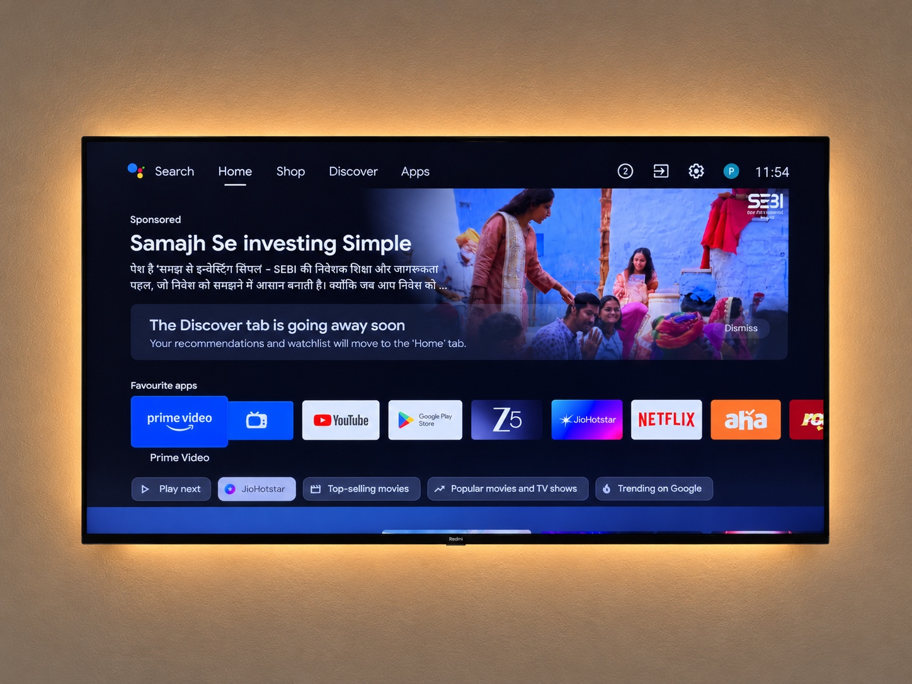

# tv-vibehack

Debloating a Xiaomi Mi TV 4A (`MiTV-MOOQ1`, codename `tarzan`, Android TV 10) over ADB, and
replacing its launcher with a tiny custom one. Everything here was done in one afternoon with
Claude Code talking to the real TV. The prompt to reproduce it on your own Android TV is in
[`PROMPT.md`](PROMPT.md).

| Before | After |
|---|---|
|  |  |

## What was done (2026-10-17)

- Disabled 25 packages: Xiaomi analytics, PatchWall and its content rows, SmartShare, MiLink,
  TV Manager, the update service, Alexa bridge, Mi Music, Play Games, Duo, demo apps and two
  unused streaming apps. Full list with reasons in `debloat.txt`.
- Uninstalled TV Bro browser at the user's request.
- Replaced the Google TV launcher with a custom home screen (`launcher/`), see below.
- Halved system animation durations.
- Kept: Netflix, Prime Video, Hotstar, SonyLIV, Zee5, Aha, Roja, YouTube, Google Assistant,
  Chromecast, Miracast, Mi media player.

Apart from TV Bro nothing was uninstalled; `./restore.sh` re-enables the disabled apps and the
stock launcher.

## The launcher (`launcher/`)

A tvOS-style Android TV home screen, package `com.gathin.tvhome`:

- Pitch-black background, like Apple TV 4K.
- Top left: greeting, a large light clock with AM/PM and the date, set in the Outfit typeface
  (`res/font/outfit.ttf`, SIL Open Font License, from Google Fonts).
- Top right, frosted glass pills: **Inputs** (opens a glass dropdown under the pill listing
  HDMI 1-3, AV and Live TV with icons; a port that reports a definite connected/disconnected
  state shows it; selection switches via the TV input framework), **Wi-Fi** (shows the connected
  network name, opens network settings) and **Settings**. Reading the network name needs location permission on Android 10; the install
  script grants it over adb.
- A pinned dock row at the bottom of the screen inside a lighter rounded band: Netflix, Prime
  Video, YouTube, JioHotstar (order in `FAVOURITES` in `AppAdapter.java`). The shelf above shows
  the focused dock app's name in large type with an ambient glow in a colour sampled from its
  banner. Pressing Down scrolls the dock up and reveals the remaining apps alphabetically, 4 per
  row; Up brings the dock back down.
- One floating "liquid glass" highlight (`GlassView`) springs from tile to tile with a soft
  overshoot instead of per-tile borders; the focused tile also scales up and, outside the dock,
  shows its name underneath. Tiles animate in with a stagger.
- Up/Down move exactly one row; Up from the dock goes to the top bar. Click launches, long-press
  opens the app's info page. The last focused tile is remembered when you come back.
  Live TV and Mi Gallery are hidden (edit `HIDDEN` in `AppAdapter.java`).

Build and install (needs JDK 17, Gradle and Android command-line tools from Homebrew, plus the
Python venv under `tools/`):

```bash
launcher/build-and-install.sh
```

Projectivy Launcher was tried first and dropped because custom wallpapers are a paid feature.

## Talking to the TV

The stock `adb` binary is blocked by macOS "Local Network" privacy (it fails with
`No route to host` even though the port is open). `tools/tv.py` is a pure-Python ADB client
that works around this.

```bash
python3 -m venv tools/venv && tools/venv/bin/pip install -r tools/requirements.txt
tools/venv/bin/python -I tools/tv.py --probe                    # device info
tools/venv/bin/python -I tools/tv.py 'pm list packages -d'      # one command
printf 'cmd1\ncmd2\n' | tools/venv/bin/python -I tools/tv.py --batch   # many commands, one connection
tools/venv/bin/python -I tools/tv.py --pull /sdcard/screen.png screen.png
tools/venv/bin/python -I tools/b64push.py local.apk /data/local/tmp/x.apk   # file upload
```

`--push` in tv.py only works for files under about 64 KB on this TV; `b64push.py` sends larger
files as base64 chunks over the shell and verifies the md5.

The TV IP defaults to `192.168.0.131`; override with `TV_HOST=...`. USB debugging must be on
(Settings → Device Preferences → About → tap Build 7 times → Developer options). On this model
there is no separate wireless-debugging toggle; USB debugging opens network ADB on port 5555.
The first connection shows an "Allow USB debugging?" prompt on the TV. The RSA key lives in
`tools/adbkey/` (git-ignored).

## Re-enable a single app

```bash
tools/venv/bin/python -I tools/tv.py 'pm enable com.xiaomi.mitv.updateservice'
```

## Backups

`backup/` holds the full package list captured before any change, plus the disabled lists before
and after. The raw `getprop` and `settings` dumps are kept locally only (git-ignored) because they
contain device identifiers.

## Licence

MIT, see [`LICENSE`](LICENSE). The Outfit typeface is under the SIL Open Font License, see
`launcher/FONT-LICENSE-OFL.txt`.
