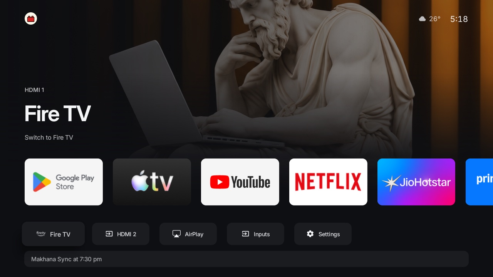
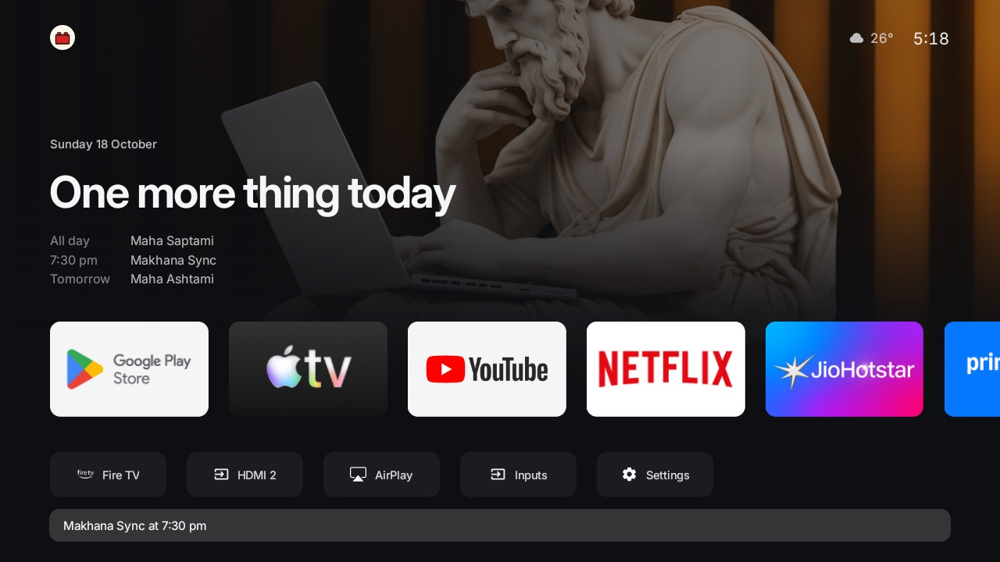
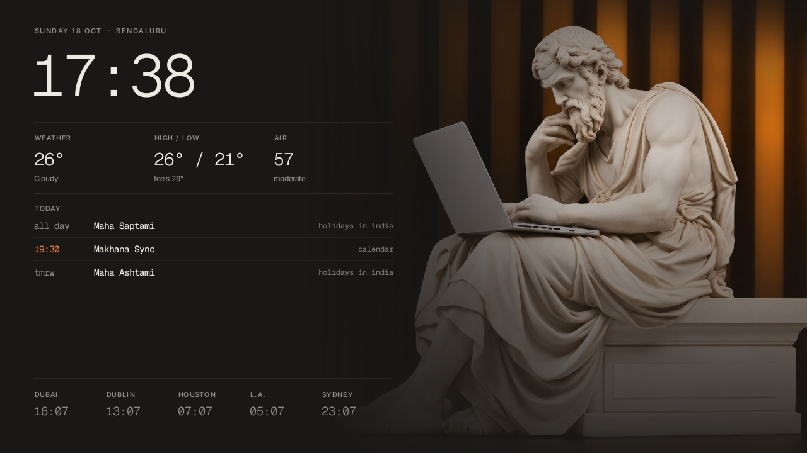
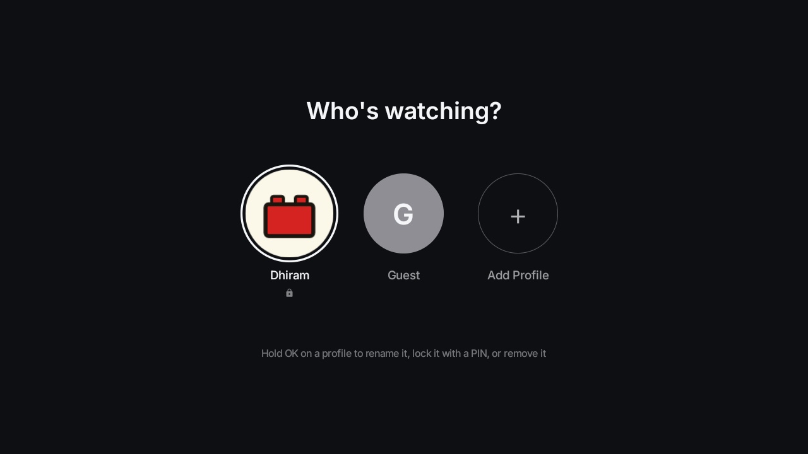
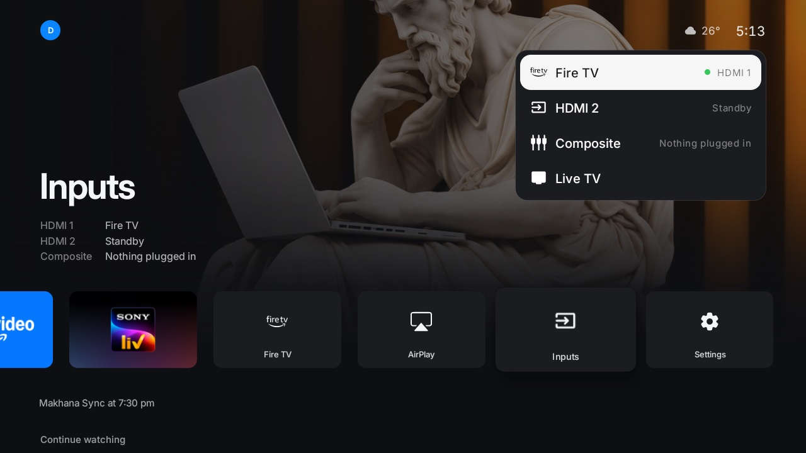

# oneplus-tv

A OnePlus Y Series Android TV turned into something that feels like an Apple TV: a custom home screen,
an ambient screensaver, the soundbar as the only speaker, and sharp, low-latency AirPlay from a Mac or
iPhone. No ads, no sponsored rows, and everything can be undone.


| Inputs and settings, one row down | Your day as a strip | Deeper rows take over the screen |
|---|---|---|
|  |  |  |

| Screensaver | Profiles | Inputs |
|---|---|---|
|  |  |  |

## What's here

| Path | What it is | Docs |
|---|---|---|
| [`home/`](home/) | The home screen (`com.dhiram.tvhome`): apps, inputs, your day, Continue Watching, TMDB rows, profiles with PINs, the ambient screensaver and the soundbar guard. Native Java, no Leanback. | [docs/home.md](docs/home.md) |
| [`airplay/`](airplay/) | The AirPlay receiver, "Living Room TV": a fork of [jqssun/android-airplay-server](https://github.com/jqssun/android-airplay-server) tuned for this TV (1080p, tunneled playback, wakes the TV, back to home on disconnect). Full upstream history is kept. | [docs/airplay.md](docs/airplay.md) |
| [`airplay-dist/`](airplay-dist/) | Signed receiver APKs: the original F-Droid 0.0.31 (rollback) and our builds. `livingroom-v3.apk` is the one installed. | [docs/airplay.md](docs/airplay.md#rollback) |
| `backup/` | The TV's state before any change (packages, settings, `getprop`). Kept on the owner's machine only: git-ignored, not published, because it identifies the TV. | [docs/tv.md](docs/tv.md#the-backup) |
| [`tools/`](tools/) | Talking to the TV: pure-Python ADB client, APK push, debloat/restore, screenshots, screensaver photo push. | [docs/tv.md](docs/tv.md#talking-to-the-tv) |
| [`examples/oneplus-y-series-shibuya/`](examples/oneplus-y-series-shibuya/debloat.txt) | The packages disabled on this TV (never uninstalled). | [docs/tv.md](docs/tv.md#debloat) |
| [`mocks/`](mocks/) | The design directions the home screen and screensaver were picked from (A, B, C). | |
| [`docs/`](docs/) | These docs, and the [changelog](docs/CHANGELOG.md). | |

## Quick start

You need the TV and a Mac on the same Wi-Fi, with USB debugging on (Settings → Device Preferences →
About → press OK on **Build** seven times → Developer options → **USB debugging**).

```bash
# 1. Tools (once)
python3 -m venv tools/venv && tools/venv/bin/pip install -r tools/requirements.txt
brew install openjdk@17 android-commandlinetools
sdkmanager "platforms;android-34" "platforms;android-36" "build-tools;34.0.0" "build-tools;35.0.0" "ndk;27.0.12077973" "cmake;3.22.1"
git submodule update --init --depth 1        # the receiver's third-party sources
export TV_HOST=192.168.68.113                # the TV's IP
tools/venv/bin/python -I tools/tv.py --probe # accept "Allow USB debugging?" on the TV the first time

# 2. Home screen: keys go in home/local.properties (git-ignored), see docs/home.md#keys
home/build-and-install.sh

# 3. AirPlay receiver: build, sign, install (docs/airplay.md#build-and-install)
```

`home/build-and-install.sh` builds a release APK, installs it, compiles it ahead of time, grants what
it needs over ADB and makes it the home screen and screensaver. It is safe to re-run, and it only
jumps to home if home was already on screen.

## Living with it

- **Volume:** the soundbar's own remote. The TV's volume is held at 0 so its speakers stay silent
  (the soundbar is on optical, which ignores the TV volume). The Mac/iPhone slider still works during
  AirPlay. See [docs/home.md](docs/home.md#soundbar-guard).
- **AirPlay:** on the Mac or iPhone, Screen Mirroring → **Living Room TV**. The TV wakes and shows it;
  when you disconnect it goes back to home.
- **Profiles:** press Up from the apps row to the avatar, then OK. Hold OK on a profile to rename it,
  lock it with a PIN or remove it.
- **Screensaver photos:** `tools/push-photo.sh photo.jpg` pins your own; `--clear` goes back to the
  daily photos.

## Undo

- Home screen: `tools/restore.sh examples/oneplus-y-series-shibuya/debloat.txt` re-enables every
  disabled package, puts the stock launcher and screensaver back and resets animation scales.
- AirPlay: install `airplay-dist/fdroid-0.0.31.apk` (uninstall ours first; it is signed with a
  different key).
- Speakers: `settings put secure enabled_accessibility_services ""` turns the soundbar guard off.
- Anything else: compare against the local `backup/` (not in the repo, see
  [docs/tv.md](docs/tv.md#the-backup)).

## Secrets

None are in the repo. The home app reads `tmdb.key` and `feed.<profile>` from
`home/local.properties`; the Apps Script feed keeps `TOKEN`, `SUPABASE_URL`,
`SUPABASE_SERVICE_KEY` and its three queries (`OCCUPANCY_PATH`, `WINS_PATH`, `VISITORS_PATH`) in its
own script properties. `tools/adbkey` (the ADB key the TV trusts), `tools/venv` and the TV backup
(`backup/`) are git-ignored.

## Credits and licences

- Started from [Gathin23/tv-vibehack](https://github.com/Gathin23/tv-vibehack) (MIT, see
  [`LICENSE`](LICENSE)): `tools/`, the debloat approach, and the template's own launcher, kept in
  [`launcher/`](launcher/) with its [`PROMPT.md`](PROMPT.md) and [`CONTRIBUTING.md`](CONTRIBUTING.md).
- `airplay/` is GPL-3.0 ([`airplay/LICENSE`](airplay/LICENSE)), from
  [jqssun/android-airplay-server](https://github.com/jqssun/android-airplay-server), built on
  [UxPlay](https://github.com/FDH2/UxPlay) (GPL-3.0), libplist, OpenSSL and FFmpeg.
- Fonts: Inter and Geist Mono, SIL Open Font License (`home/FONT-LICENSE-*.txt`).
- Artwork and metadata from TMDB; weather from Open-Meteo; screensaver photos from Bing, Google Earth
  View and the Art Institute of Chicago.
